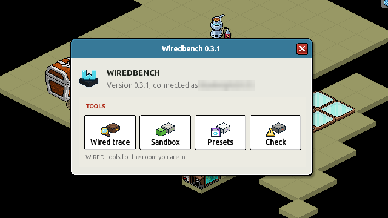
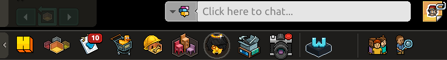
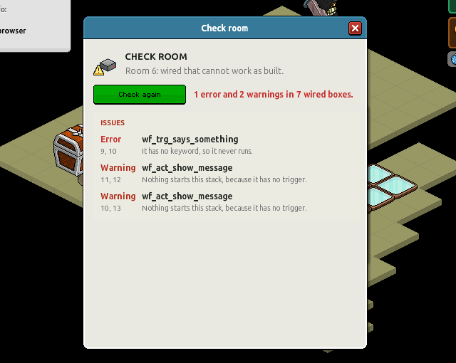
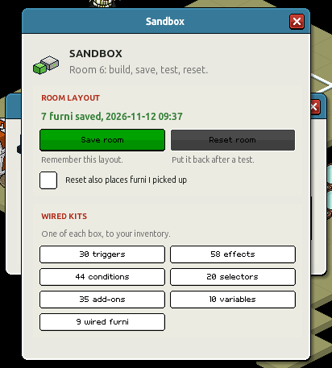

  

<h1 align="center">Wiredbench</h1>

Local Sandbox for Habbo WIREDs: build, run and debug WIRED in a sandbox hotel, then take it to a real room through G-Presets.

Wiredbench is a plugin for the [Turbo](https://github.com/nitrodevco/turbo-cloud) hotel server, with a
module for its Nitro client and pages in its admin panel. You build WIRED in the hotel's own client,
and Turbo runs it as Habbo does.

Wiredbench is not affiliated with, endorsed, sponsored, or specifically approved by Sulake Oy or its Affiliates. Wiredbench may use the trademarks and other intellectual property of Habbo, which is permitted under Habbo Fan Site Policy.

## What it does

  

The toolbar's Wiredbench icon opens the window above; each tool has its own window.

  

- **Wired trace:** follow each stack run in the room: what triggered it, each condition's answer
  and each effect, with the room's time.
- **Sandbox:** save a room as built, put it back after a test, and take kits of every wired box.
- **Presets:** import G-Presets files at a picked tile, on their own tiles or into a new room, and
  export a room as one. The library starts with five tutorial rooms.
- **Check room:** find wired that cannot work as built, without running it.
- **`:copy <name> <hotel>`:** wear a Habbo user's look and keep it in your wardrobe.
- **Admin panel:** WIRED use across loaded rooms, the preset library, and how many of the Habbo
  client's wired codes Turbo and Nitro have (parity).

  
  

## Run it

Needs .NET SDK 10, Node 24 and MariaDB with a Turbo database. See [docs/turbo.md](docs/turbo.md)
for setting up and running Turbo, the client and the panel with this plugin, and for the scripts.

`vendor/` holds Turbo and the Nitro client as git submodules. They carry no licence, so they are
private copies under their own terms and are not part of this repository.

## History

Wiredbench began as its own web app: a room editor, a Python WIRED engine and a mock of Habbo's
Web API. It moved onto Turbo in November 2026, and the app was removed. Its plan and changelog are
in [PLAN.md](PLAN.md) and [CHANGELOG.md](CHANGELOG.md); [docs/phase7-audit.md](docs/phase7-audit.md)
says where each part went. The plugin's own changes are in
[turbo-plugin/CHANGELOG.md](turbo-plugin/CHANGELOG.md).

## Icons

The icons and the logo are pixel art drawn by `scripts/make_icons.py`, in the look of Habbo's WIRED
banners: the toolbar, window and panel icons (`turbo-plugin/wwwroot/`), the client's tab icon and
[docs/wiredbench-logo.svg](docs/wiredbench-logo.svg).

## Security

Report a security problem through a private GitHub security advisory on this repository.

## Licence

[MIT](LICENSE). This covers Wiredbench's own code only, not Turbo's, Nitro's, or Habbo's data or
assets.
